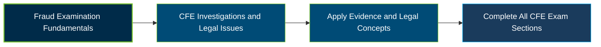

# ACFE CFE Fraud Investigations and Legal Issues Exam Guide

 

A dedicated study guide for candidates preparing for the **Certified Fraud Examiner (CFE) Exam — Fraud Investigations and Legal Issues** section, covering investigative planning, evidence handling, data analysis, interviewing, and legal procedures.

---

## Exam Overview

The Fraud Investigations and Legal Issues section evaluates knowledge of conducting fraud examinations, gathering and analyzing evidence, interviewing, and understanding legal issues that can affect investigations and their outcomes.

- **Exam Format**: Closed-book, closed-notes exam section with multiple-choice and True/False questions.
- **Target Audience**: Fraud examiners, investigators, auditors, compliance professionals, and legal or financial crime practitioners.
- **Prerequisites**: Candidates must meet ACFE's CFE Exam eligibility requirements, including its qualifying-point and application requirements.

---

## Core Exam Domains & Knowledge Areas

### 1. Planning and Conducting a Fraud Examination

- Developing a fraud response plan and establishing investigative objectives.
- Planning examination steps, predication, and potential legal proceedings.
- Maintaining confidentiality throughout a fraud examination.

### 2. Legal Issues in Conducting Investigations

- Employee rights, duties to cooperate, and contractual obligations.
- Workplace privacy, searches, surveillance, and whistleblower protections.
- Potential legal violations, including defamation and invasion of privacy.

### 3. The Law Related to Fraud

- Key elements of the Foreign Corrupt Practices Act and UK Bribery Act.
- Misrepresentation, falsification, breach of trust, and obstruction.
- Mail fraud, wire fraud, perjury, and conspiracy.

### 4. Basic Principles of Evidence

- Differences between direct and circumstantial evidence.
- Evidence admissibility, authentication, relevance, and chain of custody.
- Witness credibility, evidentiary standards, and legal privilege.

### 5. Collecting Evidence

- Documentary, digital, and testimonial evidence collection.
- Evidence storage, preservation, and appropriate disposal considerations.
- Digital forensics, e-discovery, electronic evidence volatility, and documentation.

### 6. Data Analysis and Reporting Tools

- Key stages of the data analysis process and data collection challenges.
- Analytical techniques such as Benford's Law, sorting, joining, and textual analytics.
- Data visualization, interpretation limits, and responsible data sharing.

### 7. Sources of Information

- Public and nonpublic records used in fraud examinations.
- Legal requirements for accessing financial, credit, and other restricted records.
- Open-source intelligence, online evidence documentation, and privacy considerations.

### 8. Tracing Assets

- Distinguishing legitimate transactions from illicit financial activity.
- Tracing suspicious transactions through financial records.
- Identifying hidden assets and methods for asset recovery.

### 9. Interview Theory and Application

- Interview planning, legal considerations, and cultural awareness.
- Rapport building, questioning methods, and interview documentation.
- Assessing responses, handling resistance, and adapting interview techniques.

### 10. Admission-Seeking Interviews

- Purpose and preparation of admission-seeking interviews.
- Interview stages, direct accusations, and evaluation of responses.
- Establishing admissions and preparing signed statements appropriately.

### 11. Covert Operations

- Purpose, planning, and documentation of covert operations.
- Legal issues involving recordings, entrapment, sources, and informants.
- Confidentiality limitations and operational risk management.

### 12. Report Writing

- Defining the purpose, audience, and scope of an investigation report.
- Structuring clear, accurate, evidence-based reports.
- Presenting findings and follow-up recommendations effectively.

### 13. Overview of the Legal System

- Determining jurisdiction, venue, and applicable legal processes.
- Differences between common-law adversarial and civil-law inquisitorial systems.
- Criminal versus civil action and challenges in international cases.

### 14. Criminal Prosecutions

- Burden of proof, corporate criminal liability, and criminal discovery.
- Stages of prosecution, from charging through trial, sentencing, and appeal.
- Roles of participants and corporate deferred prosecution agreements.

### 15. Non-Criminal Actions

- Civil standards of proof and preservation of evidence during litigation.
- Lawsuit procedures, discovery, remedies, and alternative dispute resolution.
- Administrative actions, penalties, and regulatory or licensing jurisdiction.

### 16. Testifying

- Differences among expert, fact, and subject-matter witnesses.
- Qualifications and obligations of expert witnesses.
- Direct testimony, cross-examination, and effective courtroom communication.

---

## Certification Path

This diagram represents a suggested study progression, not an official sequence of separate certifications.

---

## Recommended Practice & Study Resources

Use the current ACFE content outline and official study materials as the foundation for exam preparation.

- **CertsGate**: Explore supplementary [CFE Fraud Investigations and Legal Issues preparation resources](https://certsgate.com/exams/acfe/cfe-fraud-investigations-and-legal-issues) to reinforce concepts and identify areas for further review.
- **Practical Study Resource**: Practise organizing a mock fraud investigation, documenting evidence and chain of custody, analyzing sample transactions, preparing interview plans, and outlining evidence-based investigation findings.
